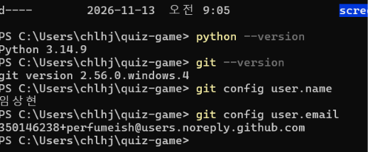
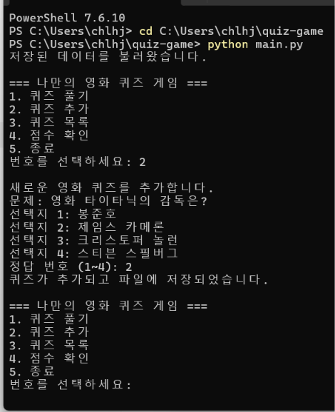
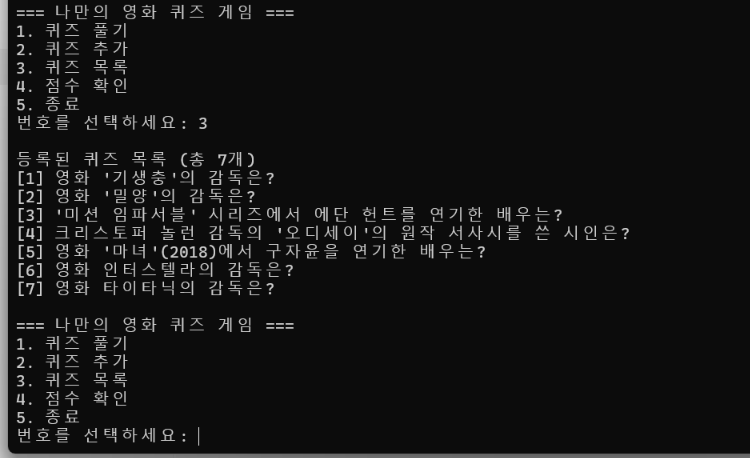
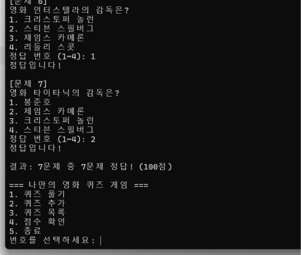
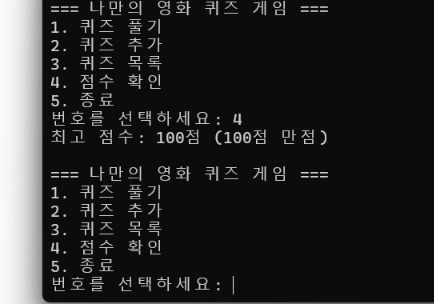
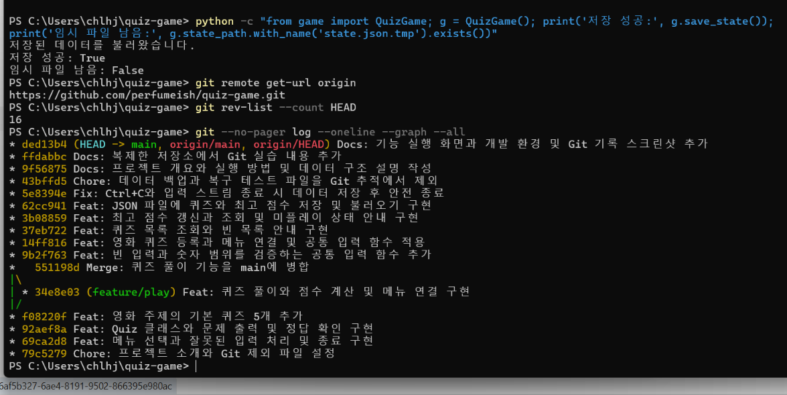
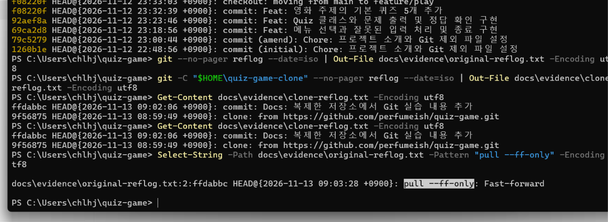

# 나만의 영화 퀴즈 게임

## 프로젝트 개요
Python으로 만든 콘솔 퀴즈 게임입니다.
영화 퀴즈를 풀거나 새로운 문제를 등록하고, 최고 점수를 확인할 수 있습니다.

## 퀴즈 주제와 선정 이유
주제는 영화입니다.
관심 있는 영화의 감독, 배우, 원작을 문제로 만들면
재미있게 퀴즈를 풀면서 Python을 학습할 수 있다고 생각했습니다.

## 개발 환경
- Python 3.10 이상
- Git
- VS Code
- 외부 라이브러리 없이 표준 라이브러리만 사용

## 실행 방법
터미널에서 프로젝트 폴더로 이동한 뒤 실행합니다.

```powershell
python main.py
```

메뉴에서 1~5번을 선택합니다.

## 기능 목록
1. 퀴즈 풀기: 정오답 안내와 백분율 점수 계산
2. 퀴즈 추가: 문제, 선택지 4개, 정답 번호 등록
3. 퀴즈 목록: 등록된 문제 제목 확인
4. 점수 확인: 완료한 게임의 최고 점수 조회
5. 종료: 현재 데이터를 저장하고 종료

## 파일 구조
```text
quiz-game/
├── main.py          # 메뉴와 안전한 종료 처리
├── game.py          # QuizGame 클래스와 게임 진행 및 파일 입출력
├── quiz.py          # 개별 문제를 표현하는 Quiz 클래스
├── quiz_data.py     # 기본 영화 퀴즈 5개
├── input_utils.py   # 공통 입력 검증 함수
├── README.md        # 프로젝트 설명
├── .gitignore       # Git 제외 규칙
└── state.json       # 실행 중 생성되는 저장 파일
```

## 데이터 파일 설명
데이터는 프로젝트 루트의 state.json에 UTF-8로 저장합니다.

- quizzes: 문제 목록
  - question: 문제 문장
  - choices: 선택지 4개
  - answer: 정답 번호인 1~4 사이의 정수
- best_score: 0~100 사이의 최고 점수
  - 아직 완료한 게임이 없으면 null

퀴즈 추가, 게임 완료, 프로그램 종료 시 저장합니다.
재실행 시 저장 파일을 불러옵니다.
state.json과 테스트용 백업 파일은 Git에 포함하지 않습니다.

## 입력 및 예외 처리
- 입력 앞뒤 공백 제거
- 빈 입력, 숫자가 아닌 입력, 허용 범위 밖 입력 안내
- Ctrl+C 또는 입력 스트림 종료 시 저장 후 안전하게 종료
- 저장 파일이 없으면 기본 퀴즈로 시작
- 저장 파일이 손상되면 안내 후 기본 퀴즈로 시작
- 파일 읽기 및 쓰기 실패 시 안내 메시지 출력
## Git 복제 실습
별도 폴더에서 clone한 저장소의 README를 수정했습니다.

## 실행 화면

### 개발 환경


### 퀴즈 추가


### 퀴즈 목록


### 퀴즈 풀이


### 최고 점수


### Git 커밋 및 병합 기록


## Git 작업 기록과 증빙

- 원격 저장소: https://github.com/perfumeish/quiz-game
- 커밋 목록: https://github.com/perfumeish/quiz-game/commits/main
- 제출 준비 시점 커밋 수: 16개
- [원격 주소·커밋 수·병합 그래프](docs/evidence/git-history.txt)
- [Git 기록 스크린샷](docs/screenshots/git-log.png)

### 커밋 단위와 메시지 규칙
메뉴, Quiz 클래스, 기본 문제, 풀이, 등록, 목록, 점수,
파일 저장 등 확인 가능한 기능 단위로 커밋했습니다.

메시지는 `타입: 변경 내용` 형식을 사용합니다.

- Feat: 기능 추가
- Fix: 오류 수정
- Refactor: 동작을 유지하면서 구조 개선
- Docs: 설명서와 증빙 추가
- Chore: 프로젝트 설정과 제외 규칙 관리

예: `Feat: 퀴즈 목록 조회와 빈 목록 안내 구현`

### 브랜치 분리와 병합 이유
풀이 기능은 main에서 분리한 feature/play 브랜치에서 개발했습니다.
기본 코드와 개발 중인 변경을 분리하고 기능 단위로 검증하기 위해서입니다.

풀이와 메뉴 연결을 확인한 뒤 main으로 병합했습니다.
`--no-ff` 옵션으로 병합 커밋을 남겨 개발 흐름을 확인할 수 있게 했습니다.

- 풀이 기능 커밋: 34e8e03
- 병합 커밋: 551198d
- 병합은 분리된 브랜치의 변경을 main에 통합하는 작업입니다.

### clone과 pull 실습
1. GitHub 저장소를 별도 quiz-game-clone 폴더에 clone했습니다.
2. 복제한 폴더에서 README에 Git 복제 실습 내용을 추가했습니다.
3. ffdabbc 커밋을 만들고 GitHub에 push했습니다.
4. 원래 quiz-game 폴더에서 `git pull --ff-only`를 실행했습니다.
5. README 마지막 부분을 확인하여 변경 반영을 검증했습니다.

clone은 저장소를 새 폴더에 복제하고,
pull은 기존 저장소에 원격 변경을 가져와 통합합니다.

### clone·pull 실행 증빙
- [복제 폴더의 clone·커밋 기록](docs/evidence/clone-reflog.txt)
- [원래 폴더의 pull·브랜치 이동·병합 기록](docs/evidence/original-reflog.txt)



## 코드 설계와 역할 분리

### 클래스를 사용한 이유
Quiz는 문제·선택지·정답과 관련 동작을 하나로 묶습니다.
문제마다 객체를 만들면 각 문제의 데이터를 구분하고 같은 메서드로 처리할 수 있습니다.

QuizGame은 퀴즈 목록과 최고 점수처럼 게임 전체에서 유지할 상태를 관리합니다.
함수만 사용하면 이 상태를 여러 함수에 매개변수로 전달해야 합니다.
클래스는 상태와 관련 기능을 묶기 편하지만, 작은 프로그램에서는
클래스 구조와 self 사용이 오히려 복잡하게 느껴질 수 있습니다.

### 핵심 메서드

| 클래스 | 메서드 | 책임 |
|---|---|---|
| Quiz | __init__ | 문제, 선택지, 정답 저장 |
| Quiz | display | 문제와 선택지 출력 |
| Quiz | check_answer | 입력한 번호의 정답 여부 반환 |
| Quiz | to_dict | JSON 저장용 딕셔너리 반환 |
| QuizGame | play | 문제 출제, 정답 판정, 점수 계산 |
| QuizGame | add_quiz | 새 문제 입력과 등록 |
| QuizGame | list_quizzes | 문제 목록 출력 |
| QuizGame | show_score | 최고 점수 출력 |
| QuizGame | save_state | 퀴즈와 최고 점수 파일 저장 |
| QuizGame | load_state | 파일 읽기, 데이터 검증, 상태 복원 |

### 파일을 분리한 이유
- main.py: 메뉴와 종료 흐름을 관리합니다.
- quiz.py: 개별 문제의 데이터와 동작을 관리합니다.
- game.py: 게임 진행과 상태 저장·복원을 관리합니다.
- quiz_data.py: 기본 문제를 게임 로직과 분리합니다.
- input_utils.py: 입력 검증을 여러 기능에서 재사용합니다.

이렇게 분리하면 문제 내용 변경이 메뉴 코드에 영향을 주지 않고,
입력 검증이나 정답 확인을 따로 실행해서 확인할 수 있습니다.
다만 현재 game.py는 진행과 파일 입출력을 함께 담당합니다.
규모가 커지면 저장 책임을 별도 클래스로 분리할 수 있습니다.

## 저장 데이터 설계

### JSON을 선택한 이유
JSON은 Python의 list와 dict를 파일로 표현하기 쉽고,
사람이 내용을 읽고 확인할 수 있습니다.
표준 라이브러리 json만으로 처리할 수 있어 외부 설치가 필요하지 않습니다.

### 데이터 구조 예시
아래는 형식 설명을 위해 문제를 한 개만 넣은 예시입니다.

```json
{
    "quizzes": [
        {
            "question": "영화 '기생충'의 감독은?",
            "choices": ["박찬욱", "봉준호", "최동훈", "류승완"],
            "answer": 2
        }
    ],
    "best_score": 100
}
```

### 필드와 중첩 구조를 선택한 이유
- quizzes: 여러 문제를 순서대로 출제하기 위해 리스트를 사용합니다.
- 각 문제: question, choices, answer를 하나의 딕셔너리로 묶습니다.
- choices: 보기의 순서가 정답 번호와 연결되므로 리스트로 저장합니다.
- answer: 1~4의 번호로 저장해 입력값과 바로 비교합니다.
- best_score: 문제 수가 달라도 비교할 수 있도록 백분율 점수를 저장합니다.
- best_score의 null: 아직 완료한 게임이 없다는 뜻이며 실제 0점과 구분합니다.

최상위 객체에 quizzes와 best_score를 함께 두어
문제 목록과 게임 전체의 최고 점수를 한 파일에서 복원합니다.

### 기본 문제 구성
| 영화 | 문제 내용 | 정답 |
|---|---|---|
| 기생충 | 감독 | 봉준호 |
| 밀양 | 감독 | 이창동 |
| 미션 임파서블 | 에단 헌트 역 배우 | 톰 크루즈 |
| 오디세이 | 원작 서사시의 시인 | 호메로스 |
| 마녀(2018) | 구자윤 역 배우 | 김다미 |

### JSON 저장 방식의 한계
현재 방식은 파일 전체를 읽어 메모리에 올리고, 저장할 때 전체를 다시 씁니다.
문제가 많아지면 메모리 사용량과 읽기·쓰기 시간이 증가합니다.
또한 여러 프로그램을 동시에 실행하면 나중에 저장한 데이터가
먼저 저장한 변경을 덮어쓸 수 있습니다.

현재 프로그램은 한 번에 하나의 프로세스에서 사용하는 것을 전제로 합니다.
데이터가 커지거나 동시 사용이 필요하면 SQLite 같은 데이터베이스와
트랜잭션을 사용하는 방식이 적합합니다.

## 데이터 오류와 복구 절차

### 현재 오류 처리
| 상황 | 프로그램 동작 | 사용자가 할 일 |
|---|---|---|
| 저장 파일 없음 | 기본 퀴즈로 시작 | 새 데이터를 저장하며 사용 |
| JSON 문법 또는 필드 손상 | 안내 후 기본 퀴즈로 시작 | 백업이 있으면 복원 |
| 읽기 권한 오류 | 안내 후 기본 퀴즈로 시작 | 경로와 파일 권한 확인 |
| 쓰기 실패 | 저장 실패 안내, 메모리 상태 유지 | 공간과 권한 확인 후 종료 시 저장 재시도 |

저장 실패 시 자동으로 반복 재시도하지 않습니다.
프로그램 종료 시 finally에서 다시 저장을 시도합니다.
저장되지 않은 상태로 프로세스가 끝나면 메모리의 변경은 사라집니다.

### 주의 사항
손상된 파일로 시작하면 기본 퀴즈가 메모리에 준비됩니다.
이후 퀴즈 추가, 게임 완료 또는 종료 시 저장하면 기존 파일을 덮어씁니다.
기존 데이터를 보존하려면 실행 전에 손상 파일을 별도로 복사해야 합니다.
현재 자동 백업과 파일 잠금은 구현하지 않았습니다.

### 수동 백업
게임을 종료한 상태에서 프로젝트 폴더의 PowerShell에서 실행합니다.

```powershell
Copy-Item state.json state.backup.json
```

이미 백업이 있다면 필요한 백업인지 확인한 뒤 다른 이름을 사용합니다.

### 백업으로 복원
게임을 종료한 뒤 실행합니다.
복원 명령은 현재 state.json을 백업 내용으로 교체합니다.

```powershell
Copy-Item state.backup.json state.json -Force
python main.py
```

복원 후 메뉴의 목록과 최고 점수에서 데이터를 확인합니다.

### 기본 데이터로 수동 초기화
게임을 종료한 상태에서 기존 파일을 보관하고 다시 실행합니다.

```powershell
Rename-Item state.json state.before-reset.json
python main.py
```

state.before-reset.json이 이미 있으면 다른 보관 이름을 사용합니다.
저장 파일이 없으므로 기본 퀴즈 5개와 미플레이 상태로 시작합니다.
기본 상태는 프로그램 종료 시 새 state.json에 저장됩니다.

### 실제 확인한 복구 테스트
- state.json의 이름을 바꾼 뒤 기본 퀴즈로 실행되는지 확인했습니다.
- JSON이 아닌 문자열을 저장한 뒤 손상 안내와 메뉴 출력을 확인했습니다.
- 백업을 복원하고 최고 점수 100점이 돌아오는지 확인했습니다.

## 요구사항 변경 시 수정할 위치

| 변경할 내용 | 파일과 함수·메서드 | 함께 확인할 사항 |
|---|---|---|
| 메뉴 문구와 선택 번호 | main.py의 show_menu, main | 표시 번호와 기능 연결 일치 |
| 기본 영화 문제 | quiz_data.py의 create_default_quizzes | 선택지 4개, 정답 번호 1~4 |
| 문제 출력 형식 | quiz.py의 display | 선택지 번호와 순서 |
| 정답 판정 | quiz.py의 check_answer | 정답·오답 사례 |
| 점수 계산과 최고 점수 | game.py의 play, show_score | 0점, 100점, 기존 최고 점수 유지 |
| 퀴즈 등록 | game.py의 add_quiz | 빈 입력 검증과 등록 후 저장 |
| 목록 출력 | game.py의 list_quizzes | 빈 목록과 여러 문제 |
| 공통 입력 검증 | input_utils.py의 read_text, read_number | 공백, 빈 입력, 문자, 범위 밖 숫자 |
| 저장 필드와 형식 | quiz.py의 to_dict, game.py의 save_state와 load_state | 저장·읽기 구조 일치, 기존 파일 호환성 |
| 저장 위치 | game.py의 __init__ | 다른 폴더에서 실행해도 같은 경로 사용 |
| 안전 종료 | main.py의 main | 일반 종료, Ctrl+C, EOF에서 저장 |

### 변경 시 주의 사항
기본 문제를 바꿔도 기존 state.json이 있으면 저장된 문제가 우선합니다.
변경된 기본 문제를 확인하려면 게임을 종료하고 저장 파일을 백업한 뒤
수동 초기화 절차를 따릅니다.

선택지 개수를 바꾸려면 기본 데이터뿐 아니라 등록 입력 범위,
풀이 입력 범위, load_state의 검증 조건도 함께 수정해야 합니다.

저장 구조를 변경할 때는 기존 파일을 읽을 수 있도록 변환 절차를 마련하거나,
백업 후 초기화가 필요하다는 점을 사용자에게 안내해야 합니다.

## 저장 안정성 개선

save_state는 state.json에 직접 쓰는 대신 다음 순서로 저장합니다.

1. 현재 데이터를 state.json.tmp에 UTF-8 JSON으로 기록합니다.
2. 파일 쓰기와 닫기가 정상 완료되면 state.json을 교체합니다.
3. 쓰기 또는 교체에 실패하면 오류를 안내하고 False를 반환합니다.

임시 파일을 쓰다가 실패해도 기존 state.json을 직접 덮어쓰지 않아
기존 저장 데이터가 중간에 잘리는 위험을 줄입니다.
정상 저장 후에는 임시 파일이 남지 않는 것을 확인했습니다.

이 방식은 자동 백업을 제공하지 않습니다.
여러 프로세스가 같은 임시 파일을 사용하면 충돌할 수 있으므로
프로그램은 한 번에 하나만 실행해야 합니다.
전원 장애에 대한 완전한 내구성도 보장하지 않습니다.
중요한 데이터는 별도의 수동 백업으로 보관합니다.

## 메뉴와 입력 처리 흐름

프로그램 시작 → 저장 데이터 불러오기 → 메뉴 출력 → 번호 입력 →
선택 기능 실행 → 메뉴로 복귀하는 순서입니다.
5번을 선택하거나 Ctrl+C·EOF가 발생하면 저장을 시도하고 종료합니다.

메뉴에서는 입력을 문자열로 비교하므로 숫자 변환 오류가 발생하지 않습니다.
앞뒤 공백을 제거한 후 1~5 이외의 값은 안내하고 다시 입력받습니다.

정답 번호 입력은 read_number에서 정수 변환과 범위 검사를 수행합니다.
빈 입력, 문자, 범위 밖 숫자에는 각각 안내하고 재입력을 받습니다.
입력 실수를 고칠 기회를 주기 위해 실패 횟수를 제한하지 않았습니다.
개인용 콘솔 게임이므로 입력 실패 로그는 별도로 저장하지 않습니다.

## 실행으로 확인한 테스트

| 테스트 | 확인 결과 |
|---|---|
| 메뉴에 문자, 범위 밖 숫자, 빈 입력 | 안내 후 재입력 |
| 정답에 문자, 0, 빈 입력 | 안내 후 재입력 |
| 공백을 포함한 숫자 입력 | 공백 제거 후 정상 처리 |
| 정답·오답 입력 | 판정과 정답 안내 정상 |
| 6문제 중 4문제 정답 | 반올림한 67점 출력 |
| 100점 이후 0점 획득 | 최고 점수 100점 유지 |
| 퀴즈 추가 후 재실행 | 추가 문제 유지 |
| 최고 점수 저장 후 재실행 | 100점 복원 |
| 저장 파일 없음 | 기본 퀴즈로 시작 |
| 손상된 JSON 파일 | 안내 후 기본 퀴즈로 시작 |
| 수동 백업 복원 | 기존 최고 점수 복원 |
| Ctrl+C와 Windows Ctrl+Z 후 Enter | 저장 후 안전 종료 |
| 임시 파일을 사용하는 저장 | 저장 성공, 임시 파일이 남지 않음 |

파일 권한 오류와 디스크 공간 부족은 실제로 재현하지 않았습니다.
해당 오류는 OSError 처리 코드로 안내하도록 구현했습니다.